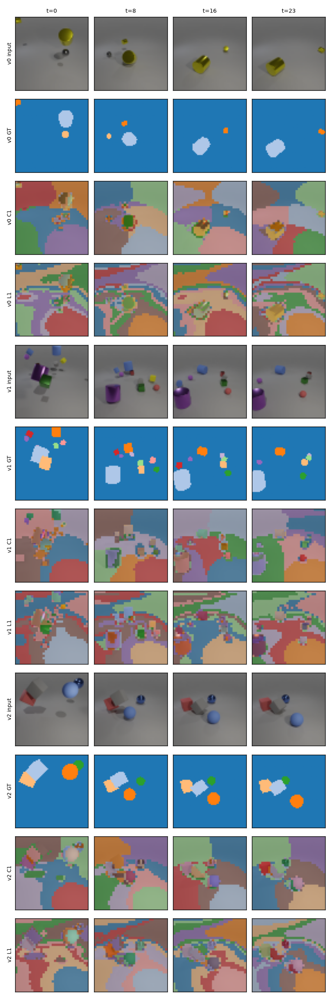

# Course-built Slot-BERT on MOVi-A

**ESE 4020 final project** — Archisa Arora, Rishabh Tole, Rayna Budigelli

> **Question.** Do Slot-BERT's ideas — a learned clustering bottleneck, recurrence across frames, and masked
> bidirectional reasoning over time — improve unsupervised object segmentation of MOVi-A videos over plain K-means?

We rebuild [Slot-BERT](https://arxiv.org/abs/2501.12477) (Liao et al., *Medical Image Analysis* 2026) from course
methods only, then climb a seven-rung ablation ladder from plain K-means to our course-built Slot-BERT, adding one idea
per rung. Everything runs on a MacBook (Apple silicon, PyTorch MPS).

---

## Contents

1. [Status](#status)
2. [Baseline results](#baseline-results)
3. [Quick start](#quick-start)
4. [The ladder](#the-ladder)
5. [Method](#method)
6. [Data](#data)
7. [Evaluation](#evaluation)
8. [Running each stage](#running-each-stage)
9. [Laptop budget](#laptop-budget)
10. [Repository layout](#repository-layout)
11. [Implementation notes and deviations](#implementation-notes-and-deviations)
12. [Team and ownership](#team-and-ownership)
13. [Licence and attribution](#licence-and-attribution)

---

## Status

| Piece | State |
|---|---|
| Data pipeline (download, 64×64 conversion, splits) | ✅ done |
| Patch features, PCA, metrics (FG-ARI, mBO-F, mBO-V), bootstrap | ✅ done, tested ("perfect masks score 100") |
| C1 K-means, C2 Ward, C3 temporal K-means | ✅ implemented; **C1 scored on test** |
| L1–L4 learned rungs, training loop, tuning CLI, report | ✅ implemented; **L1 trained + scored (1 seed)** |
| Validation-set tuning, C2/C3/L2–L4 test runs, 3 seeds | ⏳ next — `scripts/run_all.sh full` (~1.5 h) |
| Optional: transformer instead of BiGRU | ⏳ not started |

---

## Baseline results

The first two rungs on the **250 test videos**, all 24 frames. Hyperparameters are still the defaults (not yet
tuned on the validation split); learned rung is 1 seed. Scores ×100, mean [95% bootstrap CI, 1,000 resamples].

| Rung | FG-ARI | mBO-F | mBO-V | FG-ARI-V | Params | Minutes / run | Peak mem (GB) |
|---|---|---|---|---|---|---|---|
| **C1** K-means (baseline) | **43.3** [41.8, 44.9] | **34.3** [33.3, 35.3] | 2.8 [2.7, 2.9] | 2.7 [2.6, 2.8] | 0 | 0.2 | 3.3 (CPU RSS) |
| **L1** Slot autoencoder | 41.7 [40.0, 43.3] | 31.9 [30.9, 32.9] | 2.7 [2.6, 2.8] | 2.6 [2.4, 2.7] | 88 k | 5.9 | 2.3 (MPS) |

Paired difference **C1 → L1**: FG-ARI −1.6 [−2.1, −1.1], mBO-F −2.4 [−2.7, −2.2], mBO-V −0.1 [−0.2, −0.0] — all
intervals exclude zero.

**Reading it.**
- **Learning alone does not beat K-means here.** The per-frame slot autoencoder lands slightly *below* K-means on
  every metric. On MOVi-A's plain colours, a learned per-patch embedding has little to add over standardized pixels +
  PCA — exactly the "K-means may be strong" null result the proposal anticipated. L1's val curve
  (FG-ARI 40.0 → 43.8 over 2,000 steps) was still creeping up, so longer training may close the gap.
- **mBO-V is near zero for both, as it should be.** Each frame is clustered independently, so segment ids are
  arbitrary from frame to frame and no segment follows an object through the video. This is the floor that C3 and
  L2–L4 must raise; in short preliminary runs, linking frames lifted val mBO-V to ~15 (L4, 500 steps) and ~30 (C3).
- **The floor eats the slots.** With K = 11 and only 3–10 objects, the spare clusters tile the gray background
  (see overlays) and bleed into objects. Tuning K on the val split is the obvious next step.



Full output: [`results/report/test/report.md`](results/report/test/report.md) ·
[`table.csv`](results/report/test/table.csv) · [`rungs.csv`](results/report/test/rungs.csv) ·
L1 training log [`results/runs/L1_seed0/log.csv`](results/runs/L1_seed0/log.csv).

---

## Quick start

Requirements: macOS on Apple silicon (or any machine with Python 3.12; CUDA/CPU also work), [uv](https://docs.astral.sh/uv/),
~10 GB free disk for the default data subset.

```bash
git clone https://github.com/rishabh-tole/ese4020-final.git
cd ese4020-final
uv sync                                   # creates .venv with torch, sklearn, ...
uv run pytest                             # 28 unit tests, ~10 s
```

Reproduce the baseline results above (~10 min including the data download):

```bash
uv run python -m slotcourse.data.prepare download --split validation          # test set, 250 videos
uv run python -m slotcourse.data.prepare download --split train --max-shards 64  # ~1.2k train videos
uv run python -m slotcourse.data.prepare consolidate
uv run python -m slotcourse.evaluate --method C1                  # K-means baseline on test
uv run python -m slotcourse.train    --variant L1 --seed 0        # ~5 min on an M3
uv run python -m slotcourse.evaluate --method L1 --seed 0
uv run python -m slotcourse.report                                # -> results/report/test/
```

Run the whole ladder:

```bash
scripts/run_all.sh quick    # all 7 rungs, 1 seed, default hyperparameters   (~25 min)
scripts/run_all.sh full     # + validation-set tuning, 3 seeds               (~1.5 h)
```

---

## The ladder

Each row adds one thing to the row above it (C3 builds on C1; L1 is the learned reference).

| Rung | What it is | Course module |
|---|---|---|
| **C1** K-means | K-means on PCA-reduced patch features, each frame alone — **the baseline** | 8 Unsupervised learning |
| **C2** Hierarchical | Same features, Ward tree cut into K clusters, each frame alone | 8 |
| **C3** Temporal K-means | C1, with frame *t*'s centroids starting from frame *t−1*'s | 8 |
| **L1** Slot autoencoder | MLP encoder → soft K-means slots → MLP decoder, each frame alone | 7, 8 |
| **L2** + recurrence | L1 with slots carried from frame to frame | 7 |
| **L3** + masked BiGRU | L2 + bidirectional GRU over each slot's track, trained with random frames masked | 7 |
| **L4** + slot penalty | L3 + penalty on similarity between slots — **our course-built Slot-BERT** | 4 |

How to read it: **C1 → C3** shows what carrying information across frames does *without* learning; **C1 → L1** shows
what learning adds; **L1 → L4** adds Slot-BERT's ideas one at a time. An idea helps if its rung raises mBO-V and the
paired bootstrap interval for that difference excludes zero.

---

## Method

### Where each Slot-BERT part comes from

Two parts of Slot-BERT (slot attention, the transformer) are not taught in the course; each is replaced by its
nearest course method, so the project tests Slot-BERT's *ideas* rather than its exact architecture.

| Slot-BERT part | Our version | Module |
|---|---|---|
| Frozen DINO features | Raw 2×2 patch pixels + row/col (PCA-reduced for C1–C3) | 8 (PCA) |
| Slot attention | Soft K-means inside the network | 8 (K-means) |
| Feature decoder | Spatial-broadcast MLP decoder → autoencoder | 7 (MLP, autoencoders) |
| Recurrent slot init | Frame *t*'s slots start from frame *t−1*'s | 7 (RNNs) |
| Temporal transformer + masking | Bidirectional GRU over each slot track, random frames masked | 7 |
| Slot-contrastive loss | Mean squared cosine similarity between slots, added like a ridge penalty | 4 (regularization) |
| Optimiser | Mini-batch SGD with Adam, lr 1e-4 (as in the paper) | 1 |
| Choosing K, PCA size, penalty | Validation-set approach; bootstrap CIs on test | 3 |

### Input

Frames are downsampled from 128×128 to **64×64** and cut into **2×2 patches → 32×32 = 1,024 patches per frame**.
Each patch is 12 pixel values plus its row and column (14 numbers). Every method sees exactly this input.

### Clustering baselines (C1–C3)

Patch features are standardized (row/col optionally up-weighted), then projected onto the top principal components
fitted on 2,000 random training frames. K-means is a batched PyTorch implementation (k-means++ seeding, Lloyd
iterations, empty clusters keep their centre); C3 warm-starts every frame from the previous frame's centroids, so
cluster *k* descends from cluster *k* and ids carry across frames for free. C2 is scikit-learn Ward agglomeration.

### Learned model (L1–L4)

```
video [B,T,64,64,3]
  └─ patchify → [B,T,1024,14]
      └─ PatchEncoder (per-patch MLP, LayerNorm)          → keys   [B,T,1024,D]
          └─ SoftKMeans (k-means++ seeds, 3 iters;          → slots  [B,T,K,D]
             L2+: frame t warm-starts from frame t−1, 2 iters)
              └─ MaskedBiGRU over each slot's track (L3, L4) → refined slots
                  └─ assignment of keys to final slots      → masks  [B,T,1024,K]  (= segmentation)
                      └─ BroadcastDecoder(slot_k, pos_n) → rgb_k(n);  recon_n = Σ_k mask_nk · rgb_k(n)
loss = MSE(recon, pixels)  [+ λ · mean cos²(slot_i, slot_j) for L4]
```

**Soft K-means as a stand-in for slot attention.** Slot attention's update is the two K-means steps with learned
projections: a softmax over slots softly assigns each patch, then each slot becomes the weighted mean of its patches
(Slot-BERT eqs. 1–3). Ours is literally that: `assign = softmax_k(−β‖key_n − slot_k‖²/√D)`, `slot_k = Σ_n w_nk key_n`,
with a learned inverse temperature β.

**Training.** Adam (lr 1e-4) on random **6-frame windows**, batch 8, 2,000 steps by default; evaluation always uses
all **24 frames**, which tests whether consistency holds beyond the training window. For L3/L4, 30% of the frames in
each window are replaced by a learned mask token before the BiGRU.

---

## Data

**MOVi-A** from Google's [Kubric](https://github.com/google-research/kubric/tree/main/challenges/movi): synthetic
24-frame videos of 3–10 procedurally generated shapes on a gray floor, with ground-truth instance masks.

| Split | Source | Videos (default subset) | Videos (full) | Use |
|---|---|---|---|---|
| train | official train minus held-out | 971 | ~9,250 | fitting PCA / training |
| val | held out from official train (seeded) | 242 | 500 | choosing K, PCA size, mask ratio, λ |
| test | official validation | 250 | 250 | scored once, at the end |

`slotcourse.data.prepare` reads the public TFDS shards straight from
`gs://kubric-public/tfds/movi_a/128x128/1.0.0` over HTTPS with a small TF-free TFRecord parser — **no TensorFlow
needed**. Shards are streamed (download → convert → delete), so the full 62 GB train split needs only ~4 GB of disk.
The validation split is capped at 20% of downloaded training videos when only a subset is present.

```bash
# full training set (resumable; rerun to continue after interruption), then rebuild arrays
uv run python -m slotcourse.data.prepare download --split train
uv run python -m slotcourse.data.prepare consolidate
```

---

## Evaluation

Ground-truth masks are used **only** for scoring. All metrics ignore the background and are reported ×100.

| Metric | Meaning |
|---|---|
| **FG-ARI** | Adjusted Rand index between predicted segments and objects, per frame, averaged |
| **mBO-F** | Mean best-overlap IoU per frame: each object's best-matching segment |
| **mBO-V** | Same over the whole video volume — a segment that switches objects mid-video is penalised. **The metric Slot-BERT's temporal ideas should move most.** |
| FG-ARI-V | FG-ARI over the whole video volume (extra) |
| Cost | parameter count, peak memory, wall-clock minutes per run |

**Uncertainty.** Per-video scores are bootstrapped over the 250 test videos (1,000 resamples) for 95% percentile
intervals on each metric and on each rung-to-rung difference (paired, same resampled videos). Learned rungs are run
with 3 seeds and per-video scores averaged over seeds. mBO-V is also reported at evaluation lengths 6, 12 and 24 frames
(BiGRU rungs are re-run on each prefix because they see the future).

We do not compare absolute numbers with published MOVi results — our input, model size and budget differ.

---

## Running each stage

All entry points are `uv run python -m slotcourse.<module>`; add `-h` for options. Any config value can be overridden
with `--set section.key=value` (see [`configs/default.yaml`](configs/default.yaml)).

```bash
# Validation-set tuning (never touches test)
uv run python -m slotcourse.tune clustering --videos 100                     # K × PCA size × position weight
uv run python -m slotcourse.tune learned --variant L3 --param model.mask_ratio --values 0.15 0.3 0.5
uv run python -m slotcourse.tune learned --variant L4 --param model.slot_penalty --values 0.01 0.1 1.0

# Train / evaluate a rung
uv run python -m slotcourse.train --variant L4 --seed 1 --set train.steps=4000
uv run python -m slotcourse.evaluate --method L4 --seed 1            # or --method C2, --split val, --limit 20

# Tables, paired rung differences, mBO-V vs length plot, mask overlays
uv run python -m slotcourse.report
```

Outputs:

```
results/runs/<variant>_seed<s>/     config.json, log.csv (loss + periodic val metrics), meta.json (params, minutes, memory), model.pt
results/scores/<split>/<name>.npz   per-video scores, keys <metric>_L<length>
results/scores/<split>/<name>.json  run cost + mean scores
results/report/<split>/             report.md, table.csv, rungs.csv, mbo_v_vs_length.png, overlays.png
```

---

## Laptop budget

Measured on an Apple **M3, 16 GB** (the proposal names an M5 Pro; expect that to be faster).

| Step | Cost |
|---|---|
| Data: test split + 64 train shards | ~3 min, ~8 GB streamed, 0.6 GB on disk |
| C1 / C3 on 250 test videos | seconds |
| C2 (Ward on 6,000 frames) | ~4 min |
| One learned run (2,000 steps × 8 clips × 6 frames) | ~5 min, ~2.3 GB GPU memory, 88 k params (L1) |
| Evaluating a learned run (250 videos, 3 lengths) | < 1 min |
| `scripts/run_all.sh quick` / `full` | ~25 min / ~1.5 h |

The default model is deliberately small (slot dim 32, decoder width 64) — about 0.14 s per training step on the M3.

---

## Repository layout

```
configs/default.yaml        all hyperparameters (values marked "tuned" come from the val split)
scripts/run_all.sh          the whole ladder, quick or full
src/slotcourse/
  config.py                 paths and fixed constants (frame size, patch size, split seed)
  settings.py               YAML loading + --set overrides
  data/tfrecord.py          TF-free TFRecord / tf.train.Example reader
  data/prepare.py           stream MOVi-A shards → 64×64 uint8 .npy arrays (resumable)
  data/dataset.py           train / val / test splits, random-window training dataset
  features.py               patchify, positions, PCA
  baselines/kmeans.py       batched K-means (C1) and temporal K-means (C3)
  baselines/hierarchical.py Ward clustering (C2)
  models/slots.py           PatchEncoder, SoftKMeans, BroadcastDecoder
  models/video.py           SlotVideoModel (L1–L4), MaskedBiGRU, frame masking, slot penalty
  inference.py              any method → pixel-level segment ids
  metrics.py                FG-ARI, mBO-F, mBO-V
  bootstrap.py              percentile and paired-difference intervals
  train.py  evaluate.py  tune.py  report.py   command-line entry points
tests/                      metrics vs sklearn, perfect-mask = 100, features, K-means, model shapes/gradients
results/                    scores, run logs and reports (model weights are git-ignored)
```

---

## Implementation notes and deviations

- **Slot initialisation = k-means++ on the patch keys** (the same seeding C1 uses) plus a small learned offset. A
  learned-Gaussian initialisation (as in slot attention) collapsed: under near-uniform soft assignments every slot
  moved to the global mean and they never separated again.
- **The clustering is a true bottleneck.** Each patch is reconstructed as `Σ_k assign[n,k] · decode(slot_k, pos_n)` and
  the segmentation is the argmax of the assignment. A decoder that predicts its own alpha masks (as in Slot-BERT /
  DINOSAUR) learned to paint by position alone and ignore the slots on raw-pixel input.
- **Sharp initial temperature.** β starts at √D so assignments are sharp enough for the k-means++ seeds to stay distinct.
- **Masking in L3/L4 is weaker than Slot-BERT's.** A masked frame's slot *contents* must be predicted from neighbouring
  frames, but its own patch keys still choose which predicted slot each patch joins (log₂K bits per patch). Report this.
- **Per-patch MLP encoder.** No convolution / spatial context — each patch's key depends only on its 12 pixels and
  position, keeping the model close to "learned K-means".
- **Data subset by default** (64 of 512 train shards); training cost depends on steps, not dataset size.
- **Code is our own.** The official Slot-BERT repository (academic-research-only licence, surgical-data loaders) was
  used only as a reference.

---

## Team and ownership

The work splits along the pipeline; stages meet at fixed interfaces (cached arrays in, slot masks out).

| Member | Owns | Code |
|---|---|---|
| Rayna Budigelli | Data + clustering: download/conversion, patch features, PCA, C1–C3, metrics, bootstrap | `data/`, `features.py`, `baselines/`, `metrics.py`, `bootstrap.py` |
| Archisa Arora | Slot autoencoder: L1, L2, training loop, logging, speed/memory benchmark | `models/slots.py`, `models/video.py` (L1/L2), `train.py` |
| Rishabh Tole | Temporal model: BiGRU, frame masking, slot penalty (L3, L4), validation-set tuning | `models/video.py` (L3/L4), `tune.py` |

---

## Licence and attribution

**Data.** MOVi-A is part of Google's Kubric project, released under the
[Apache License 2.0](https://github.com/google-research/kubric/blob/main/LICENSE). Tables, plots and mask overlays in
this repository and our report are derivative works of MOVi-A; credit: *Greff et al., "Kubric: A Scalable Dataset
Generator", CVPR 2022.* MOVi-A uses only procedurally generated shapes, so the third-party asset licences that apply to
MOVi-C–E do not apply. There is no personal data. The Slot-BERT surgical video data is **not** used.

**Paper.** Liao et al., *Slot-BERT: Self-supervised Object Discovery in Surgical Video*, Medical Image Analysis (2026),
arXiv:2501.12477.
