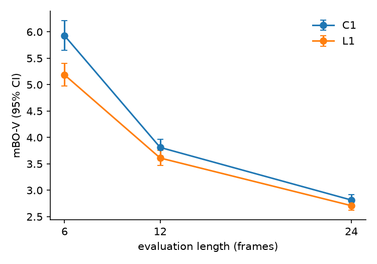
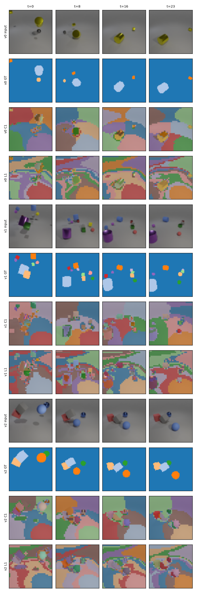

# Results (test, 250 videos, 24 frames)

Scores x100, mean [95% bootstrap CI over videos, 1000 resamples]. Learned rungs average per-video scores over seeds.

| method   |   seeds | fg_ari            | mbo_f             | mbo_v          | fg_ari_v       |   params |   minutes_per_run |   peak_mem_gb |
|:---------|--------:|:------------------|:------------------|:---------------|:---------------|---------:|------------------:|--------------:|
| C1       |       1 | 43.3 [41.8, 44.9] | 34.3 [33.3, 35.3] | 2.8 [2.7, 2.9] | 2.7 [2.6, 2.8] |        0 |               0.2 |          3.28 |
| L1       |       1 | 41.7 [40.0, 43.3] | 31.9 [30.9, 32.9] | 2.7 [2.6, 2.8] | 2.6 [2.4, 2.7] |    88365 |               5.9 |          2.33 |

## Rung-to-rung differences (paired bootstrap; * = CI excludes zero)

| comparison   | fg_ari              | mbo_f               | mbo_v               | fg_ari_v         |
|:-------------|:--------------------|:--------------------|:--------------------|:-----------------|
| C1 -> L1     | -1.6 [-2.1, -1.1] * | -2.4 [-2.7, -2.2] * | -0.1 [-0.2, -0.0] * | -0.1 [-0.3, 0.0] |

